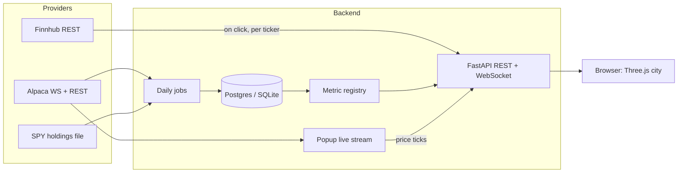

# Market City — MVP Plan

Sep 25, 2026 (updated Sep 28, 2026: metric layer built; fundamentals and live prices moved to the click-through popup) · @Jordan

## Overview

Market City renders a stock index or a personal portfolio as a 3D town: each holding is a building, its land is its weight, and the skyline reflects the latest session. Click any building to see its fundamentals and live price.

- **Footprint** = share of the index or portfolio, so the whole town adds up to 100%.
- **Height and colour** = metrics the viewer picks (1-year return, volatility, today's move, and so on).
- **Click a building** = detail popup with fundamentals (P/E, market cap, dividend yield) and a live price stream.
- **Districts** = sectors (potentially grouping stocks on some shared characteristic e.g. tech), later emergent clusters linked by correlation "roads".
- **The show-off moment:** paste in your own holdings and see your town next to the S&P 500, or replay a crash day and watch the city turn red.

## MVP scope

The MVP is the S&P 500 as a 3D city built from a daily snapshot, with a selectable height and colour metric, a click-through detail popup (fundamentals + live price), plus replay of recorded days. **Live data is popup-only:** the city itself does not stream; only the clicked stock does. This keeps the free-tier WebSocket usage to one ticker at a time. Everything else waits, but the architecture leaves a slot for it.

**In scope**

- S&P 500 constituents, weights and sectors, refreshed daily.
- Daily metric snapshot for all \~500 tickers, computed before the US open.
- Treemap layout: sectors as districts, companies as buildings.
- Height and colour dropdowns over a fixed metric catalogue, with animated transitions.
- Hover tooltip: name, ticker, weight, latest close, day change and the selected metrics (all from the snapshot, no API calls).
- Click-through detail popup: fundamentals (Finnhub, fetched on click) and a live minute-bar price stream (Alpaca WebSocket) while it is open.
- Replay mode ("yesterday in 60 seconds"), built from Alpaca historical minute bars fetched after the session, not from a live recording. Approach to be confirmed.
- One generic building style per sector (coloured boxes or simple towers).
- Deployed with a public link you can send to friends.

**Out of scope for the MVP (planned slots)**

- Live full-city updates (every building streaming minute bars). Considered and explicitly deferred; the `WS /live` endpoint can later fan out a whole universe.
- Custom portfolios and imports.
- Non-US listings and currency conversion.
- Correlation roads and emergent districts.
- Building archetypes (farms, refineries, mines).
- User accounts.

**Done when**

- [ ] A visitor opens the link and sees all \~500 buildings within 3 seconds.
- [ ] Clicking a building opens a popup with its fundamentals within 2 seconds, and during market hours its price updates each minute.
- [ ] Switching the height metric animates in under 1 second at 60 fps on a laptop.
- [ ] Outside market hours, replay of the last recorded session works.

## Visual encoding and metrics

Footprint is fixed to weight; height and colour are chosen by the viewer from the metric catalogue. Weight already reflects valuation (market-cap weighted, float-adjusted), so valuation is never also used for height.

| Channel | Default | Selectable | Notes |
| --- | --- | --- | --- |
| Footprint | Index or portfolio weight | No | Whole city sums to 100% |
| Height | 1-year return | Yes | Negative values sink below ground as basements |
| Colour | Today's % change | Yes | Diverging red–grey–green scale |
| District | GICS sector | Later: correlation clusters | Official labels in the MVP |
| Roads | None | Later | Correlation between daily returns |

**Metric catalogue (city: height and colour)**

City metrics are **price-only**: all seven come from one batched Alpaca daily-bars fetch, so they stay fast for any universe size (full S&P 500 in ~5s). Fundamentals can't drive the city on the free tier. Finnhub is one call per ticker per second with no bulk endpoint, so a 2,000-stock fund would take ~33 minutes.

| Key | Metric | Unit | Scale | Status |
| --- | --- | --- | --- | --- |
| `one_year_return` | 1-year price return | % | Percentile | Built |
| `day_change` | Latest session's % change | % | Linear (diverging colour) | Built (daily); live version later |
| `volatility_30d` | Annualised 30-day volatility | % | Percentile | Built |
| `max_drawdown_1y` | Worst 1-year peak-to-trough fall | % | Percentile | Built |
| `off_52_week_high` | Distance below 52-week high | % | Percentile | Built |
| `beta_1y` | Sensitivity to the S&P 500 (SPY) | Ratio | Linear | Built |
| `relative_volume` | Latest volume ÷ 20-day average | Ratio | Percentile | Built (daily); live version later |
| Contribution to return | Weight × return | % | Linear | Portfolio phase |

**Stock detail popup (on click)**

| Data | Source | Notes |
| --- | --- | --- |
| P/E, market cap, dividend yield | Finnhub (1 call, ~1s) | Cached per ticker per day. On click, not hover: hovering across the city would exceed 60 calls/min |
| Earnings fill | Derived: 1 / P/E | Fills that fraction of the building's height; works with any height metric |
| Live price | Alpaca WebSocket | Minute bars while the popup is open |

**Scaling rules**

- Each metric declares its own scale: linear, log or percentile. Percentile is the default, so one outlier (a +500% one-year return) cannot flatten the rest.
- Metrics store **raw values**; scaling is applied against the universe on screen, so the same value can be "high" in a portfolio and "average" in the S&P.
- Metrics with no value (e.g. a recent listing has no 1-year return) render as a flat, hatched roof rather than zero height.
- Missing data, short history and stale (halted) tickers are handled by the metric (it returns `None`), never by the renderer.
- In portfolio mode, footprint is position size rather than market cap, so market cap becomes a meaningful height metric once a bulk fundamentals source exists (see open questions).

## Data sources

The MVP runs on three free sources: the SPY holdings file for the index, Alpaca for prices (and every city metric), and Finnhub for fundamentals in the click-through popup. Each sits behind a provider interface so it can be swapped.

| Need | Source | Free-tier limits | Phase |
| --- | --- | --- | --- |
| Constituents, weights, sectors | [SPY daily holdings (State Street)](https://www.ssga.com/library-content/products/fund-data/etfs/us/holdings-daily-us-en-spy.xlsx) | Daily file, no key | MVP |
| Live US prices | [Alpaca Market Data](https://docs.alpaca.markets/us/docs/market-data-faq) | IEX feed only; 1 WebSocket connection; 30 symbols for trades/quotes but unlimited minute-bar channels | MVP |
| Historical daily bars (1-year return, volatility, correlation) | Alpaca Market Data | Free historical data 15+ minutes old | MVP |
| Fundamentals (P/E, market cap, dividend yield), popup only | [Finnhub](https://freeapi.watch/finnhub/) | 60 calls/min; free tier is US-only; no bulk endpoint | MVP |
| Bulk fundamentals for the whole city (candidate) | SEC EDGAR XBRL frames API | Free, no key; US filers only | To evaluate |
| FX rates (EUR, GBP to display currency) | Frankfurter API (ECB rates) | No key; daily rates | Phase 3 |
| Non-US prices (e.g. Airbus, AIR.PA) | To evaluate: Twelve Data, EODHD; yfinance as unofficial fallback | Not yet verified | Phase 3 |
| Commodities | Commodity ETFs (e.g. CORN, oil ETFs) via Alpaca | As Alpaca | Phase 5 |
| True futures prices | To find | Free real-time sources are scarce | Later |

**Caveats to design around**

- IEX carries only a small slice of US volume, so prices track the market but absolute volume is tiny. Use relative volume only.
- SPY is a fund, so its weights are a close proxy for the official index weights, not an exact copy. Alphabet appears twice (GOOGL and GOOG) and should merge into one building.
- Sources disagree on whether Finnhub's free tier includes WebSockets. Do not depend on it for live prices.
- yfinance is an unofficial scraper that breaks and gets rate-limited. Fine for prototyping, never a production dependency.
- Free tiers change. Re-check each provider's current terms before building on it.

## Architecture

Start as one FastAPI service (a modular monolith) with clear internal boundaries, so the ingest worker can split out later without rewriting anything.

**Core boundaries (the expansion points)**

- `PriceProvider`: `subscribe(tickers)`, `history(ticker, range)`. Alpaca first; a European provider plugs in later, routed by exchange.
- `ReferenceProvider`: constituents, weights, sectors, shares outstanding. SPY file and Finnhub first.
- `Metric`: `key`, `label`, `unit`, `scale`, `refresh`, `compute(data: MarketData) -> dict[ticker, value | None]`. `MarketData` holds the tickers and lazily fetches each data source once, shared by every metric. Adding a metric is one class plus one registry line, with no frontend change.
- `Universe`: a list of holdings (ticker + quantity or weight). The S&P 500 is just the default universe, so portfolios reuse everything.
- `Archetype` (frontend): a model plus `grow(value)`. Generic box in the MVP.

**Data model (MVP)**

| Table | Key fields |
| --- | --- |
| instrument | id, ticker, name, exchange, currency, sector, asset\_class |
| universe | id, name, kind (index / portfolio), as\_of |
| holding | universe\_id, instrument\_id, weight, quantity |
| bar\_minute | instrument\_id, ts, open, high, low, close, volume |
| bar\_daily | instrument\_id, date, OHLCV |
| metric\_value | instrument\_id, metric\_key, as\_of, value |

**API (MVP)**

| Endpoint | Returns |
| --- | --- |
| GET /universes/{id} | Positions with weights, sectors, names and **every metric value** in one payload, so metric switches need no request (built) |
| GET /metrics | Catalogue: key, label, unit, scale (built) |
| GET /instruments/{ticker} | Popup detail: fundamentals (Finnhub, cached per day) |
| GET /replay/{date}?universe={id} | Compact minute-bar timeline for that session |
| WS /live?ticker={ticker} | Popup only: minute-bar price updates for the clicked stock |

**Data flow**

1. Daily job (before US open): fetch holdings and daily bars; compute daily metrics; store per ticker (so any universe reuses them). After the close, fetch the session's historical minute bars for replay.
2. Browser loads the universe and metrics once; the city is static for the session and animates only on metric switches or replay.
3. On click: the popup fetches that ticker's fundamentals (Finnhub, cached per ticker per day) and opens `WS /live?ticker=` to stream its minute bars; the subscription closes with the popup.

**Scaling path (only when needed)**

- Share one upstream Alpaca subscription per ticker across all viewers of that popup; later split into its own worker with Redis pub/sub so several API instances can serve WebSockets.
- Move from SQLite to Postgres with TimescaleDB for minute bars.
- Cache the universe and metric responses at the CDN; they change once a day.
- Send numeric IDs and arrays, not ticker strings, on the WebSocket; switch to MessagePack if payloads grow.

## Tooling

| Area | Choice | Why |
| --- | --- | --- |
| Backend framework | FastAPI + Pydantic | Async WebSockets, typed contracts |
| Python tooling | uv, ruff, pytest, mypy | Fast installs, one linter, typed code |
| Data work | pandas (holdings parsing), stdlib `statistics` (metrics) | Metrics are fast in pure Python; add NumPy only if profiling demands it |
| Scheduling | APScheduler in-process | Enough for daily jobs; move to arq/Redis when ingest splits out |
| HTTP / WS clients | httpx, websockets (or alpaca-py) | Async, retries |
| Database | SQLite (MVP) → Postgres + TimescaleDB | Zero setup now, time-series later |
| ORM / migrations | SQLAlchemy 2 + Alembic | Standard, works with both databases |
| Frontend build | Vite + TypeScript | Fast dev server, no framework weight |
| 3D | Three.js with InstancedMesh, OrbitControls | 500 buildings in one draw call |
| Layout | d3-hierarchy (squarified treemap) | Districts and footprints without custom packing |
| Later layout | d3-force or networkx spring layout | Correlation roads and clusters |
| UI overlay | Plain HTML/CSS; lil-gui while developing | Dropdowns, slider, tooltip |
| Animation | Tween between old and new values per frame | Smooth metric switches |
| Containers | Docker + docker-compose | Same setup locally and deployed |
| Hosting | Fly.io or Railway (backend), Cloudflare Pages (frontend) | Cheap, one public link |
| CI | GitHub Actions: ruff, mypy, pytest, frontend build | Keeps the project shippable |
| Secrets | Environment variables, `.env` locally | API keys never in the repo |

## US and non-US coverage

The MVP is US-only; non-US holdings arrive in phase 3 through exchange-aware routing and a display currency. Build the MVP data model with `exchange` and `currency` on every instrument so this needs no migration.

- **Instrument identity:** store ticker + exchange (e.g. AIR on Euronext Paris), not a bare ticker. Keep ISIN as an optional field for matching broker exports.
- **Routing:** a `PriceRouter` picks the provider per exchange: US listings → Alpaca, European listings → the chosen EU provider.
- **Currency:** every price is stored in its trading currency. Weights and totals convert to one display currency (EUR or USD, user's choice) using daily ECB rates.
- **Market hours:** each exchange has its own calendar. Euronext runs roughly 09:00–17:30 Brussels time and the US 15:30–22:00, so a mixed portfolio is partly live most of the working day. Show closed markets as dimmed buildings.
- **ADRs:** some European companies also trade in the US as ADRs (Airbus as EADSY OTC). Using the ADR is a quick hack for phase 2, but liquidity and share ratios differ, so prefer the home listing.
- **Sectors:** non-US companies may use different sector schemes. Map everything to one scheme (GICS-style) in a lookup table.

## Portfolios and import

A portfolio is just another universe, so the city engine needs no changes; the work is in getting holdings in safely. Weight = holding value ÷ total portfolio value, recalculated from live prices.

1. **Manual builder (phase 2):** search a ticker, enter quantity or amount, save. US stocks first.
2. **CSV import (phase 4):** one small parser per broker export (e.g. DEGIRO, Trading 212) mapping to ticker/ISIN + quantity. Show unmatched rows for the user to fix.
3. **Broker APIs (later):** Interactive Brokers and Alpaca have real APIs; aggregators such as SnapTrade cover many brokers. Check pricing and terms first.

**Views**

- Your city on its own.
- S&P 500 city.

**Privacy and security**

- Never store broker passwords; only revocable OAuth or API tokens.
- Store holdings, not credentials. Before accounts exist, keep portfolios in the browser or behind a share link.
- A shared portfolio link shows weights by default, not amounts.

## Building archetypes

Each sector or asset class gets its own low-poly structure, and each archetype defines how it shows the height metric. Footprint always stays as weight.

| Sector / asset | Archetype | How it "grows" |
| --- | --- | --- |
| Technology | Datacenter | Taller |
| Financials | Stone building with columns | Taller |
| Energy / oil | Refinery, derricks | More derricks, taller stacks |
| Industrials (e.g. Airbus) | Factory, hangar | Taller roof, more bays |
| Healthcare | Hospital block | Taller |
| Utilities | Power plant, wind turbines | More turbines/larger turbines |
| Real estate | Apartment blocks | More floors |
| Consumer | Shops, mall | Taller or more units |
| Agriculture commodities (corn, wheat) | Farm with fields and silos | More or taller silos |
| Metals / gold | Metal/Gold Ingots | More or larger ingots |
| Natural gas | Storage tanks | More tanks/larger tanks |
| Bonds | Bank vault | Taller |
| Crypto | Casino | Taller, brighter glow |
| Cash | Park | Larger trees |

- Zoning follows naturally: farms on the edge, industry together, tech and finance as the downtown skyline.
- Assets: CC0 low-poly kits from Kenney.nl and Quaternius, loaded as glTF, one InstancedMesh per model type.
- Cheap life: turning turbines, pumping derricks, refinery smoke that thickens with relative volume.
- Generic buildings only, no company logos.

## Roadmap

Each phase ends with something you can show someone; no phase starts until the previous one is deployed.

| Phase | Delivers | Done when |
| --- | --- | --- |
| 0. Spike | Script: SPY file + Alpaca daily bars → JSON; static Three.js treemap city | You can orbit a city of 500 boxes locally |
| 1. MVP | Metric dropdowns, animated transitions, click-through popup (fundamentals + live price), replay, deploy | Public link; checklist under MVP scope is ticked |
| 2. Portfolios (US) | Manual portfolio builder, highlight-in-index and side-by-side views | A portfolio of Apple, Amazon, Nvidia renders with correct weights |
| 3. Non-US | Price router, EU provider, FX conversion, exchange calendars | Airbus sits next to Apple with weights in EUR |
| 4. Import | CSV parsers for at least two brokers | A real broker export imports with unmatched rows flagged |
| 5. Archetypes | Sector and commodity models, grow rules, small animations | Refinery, farm and tower appear in one city |
| 6. Roads | Correlation edges, force layout, emergent districts | Toggle between official sectors and emergent districts |
| 7. Crypto city | Second universe on 24/7 exchange feeds | Something moves on a Sunday |

## Risks, open questions and easy misses

**Risks**

| Risk | Impact | Mitigation |
| --- | --- | --- |
| Free API terms change or tighten | Live data stops | Provider interfaces; recorded replay keeps the demo working |
| Data licensing | Redistributing exchange data publicly may breach terms | Read Alpaca and Finnhub terms before making the site public; show derived values, not raw feeds |
| SPY file URL or format changes | Daily job fails | Validate on load; keep the last good universe; iShares IVV as backup |
| Performance on phones | Laggy city | Instancing, low-poly, cap pixel ratio, test on a mid-range phone early |
| Scope creep | Never ships | Phase gates; nothing from phase 2+ enters the MVP |

**Open questions**

- [ ] Display currency default: EUR or USD?
- [ ] Which EU price provider covers Euronext on a usable free tier?
- [ ] Replay length: last session only, or a library of notable days?
- [ ] Do portfolios need accounts, or are browser storage and share links enough until phase 4?
- [ ] Can the SEC EDGAR XBRL frames API supply bulk P/E and market cap (needs CIK↔ticker mapping and TTM summing), so fundamentals can drive the city too?
- [ ] Imported funds with uncached tickers: nightly full-US sweep plus progressive loading (biggest weights first), or keep fundamentals popup-only?

**Easy to miss**

- Index changes: companies join and leave the S&P 500; keep history by date so replays show the right city.
- Corporate actions: stock splits distort 1-year return unless you use split-adjusted bars.
- US holidays and half days: the market calendar must drive "live" versus "closed".
- Time zones: store everything in UTC; convert only in the UI.
- Empty states: before the first live bar of the day, show the previous close, not zeros.
- Accessibility: red–green colour needs a colour-blind-safe palette option.
- Disclaimer: a one-line "not investment advice" in the footer.
